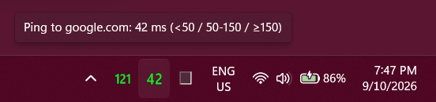
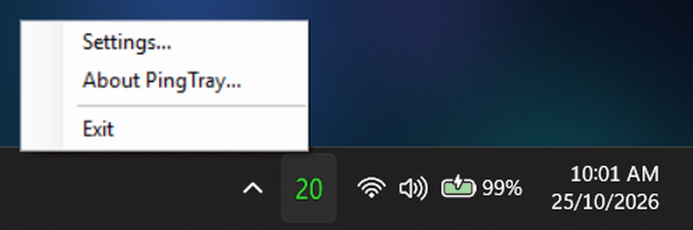
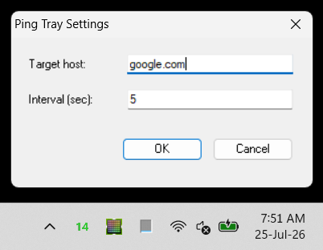
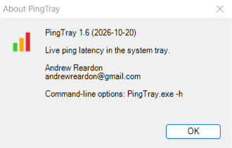

# PingTray

**v1.5** (2026-10-12) by Andrew Reardon, andrewreardon@gmail.com

Shows your network latency as a number in the system tray.



## Getting started

No installer: [download the latest release zip](https://github.com/andrewreardon-au/PingTray/releases/latest), extract it, and run `dist\PingTray.exe`.

1. Double-click `dist\PingTray.exe`.
2. Don't see the icon? Click the small **^** arrow near the clock to show hidden tray icons.
3. To close it, right-click the icon > **Exit**.



### Keeping the icon visible

By default, Windows may tuck new tray icons away under the **^** arrow instead of showing them next to the clock. To pin it:

1. Right-click the taskbar > **Taskbar settings**.
2. Click **Other system tray icons**.
3. Find **PingTray** in the list and switch it **On**.

### Starting automatically at login

In the Settings box, tick **Start with Windows** to start PingTray when you sign in. Untick it to stop.

The older method still works if you want a shortcut that uses `--target=` options. Put the shortcut in your Startup folder:

1. Right-click `dist\PingTray.exe` > **Create shortcut**.
2. Press `Win + R`, type `shell:startup` and press Enter. This opens your Startup folder.
3. Drag the shortcut you created into that folder.

To turn it off again, delete the shortcut from the Startup folder.

### Moving it to another computer

Copy the whole `PingTray` folder anywhere (a USB drive, a cloud folder) and run `dist\PingTray.exe` on the other machine. There is nothing else to install. Tick **Start with Windows** there again if you want it to start at login on that machine too.

### Microsoft Store version

A Microsoft Store version is planned. It is the same app. It installs and updates through the Store, and its settings are private to the app and removed if you uninstall it. Start at login is switched on in Windows Settings > Apps > Startup. `PingTray.exe --target=...` works from the command line and from shortcuts.

## What the number means

| Colour | Meaning (the default limits; you can [change them](#tuning-the-colours)) |
|---|---|
| 🟢 Green | Good: under 50 ms |
| 🟠 Orange | OK: 50 to 150 ms |
| 🔴 Red | Slow: 150 ms or higher |
| ⚪ Grey "0" | Offline: no response |

It checks every 5 seconds by default. Hover over the icon to see the exact number, the colour limits in force (and which connection-type [preset](#tuning-the-colours) they match), and whether the reply is as expected for that preset. When it is not, the [ready reckoner](#the-ready-reckoner) adds what it feels like.

The number is drawn big and bold with a thin outline, so it reads on any taskbar colour. On a light Windows taskbar the colours switch to darker shades. The offline "0" is a plain dark grey, so it looks dull and inactive but still shows on both dark and light taskbars.

A single missed reply doesn't flip it to offline, which is normal on flaky connections like 4G. It takes **3 misses in a row** before it shows the grey "0". Until then it keeps showing your last good reading, and hovering shows something like `no response 1/3 (last: 23ms)`, so you can see it is struggling without the number jumping around.

## Changing what it watches

Click the tray icon (or right-click > **Settings...**) to open the Settings box. You can change the target host, how it checks (ping, TCP connect or a DNS query), how often it checks, and what counts as green, orange and red. Click **OK** and it applies at once, with no restart. Your choice is remembered for next time (when you start it normally, without command-line options).



Settings checks what you type before it closes. If something is wrong, the box stays open, the hint at the bottom turns red and says what to fix, and the cursor goes to that box. The target can be a host name (`example.com`, `router`), an IP address (four numbers from 0 to 255 separated by dots, like `1.1.1.1`) or an IPv6 address. Something like `1.1.1` or `010.1.1.1` is refused rather than guessed at: Windows would read them as 1.1.0.1 and 8.1.1.1, and you would be watching a different address from the one you typed. The interval is 1 to 86400 seconds, a port 1 to 65535, and the colour limits 1 to 2000 ms with red above orange.

By default it pings `1.1.1.1` (Cloudflare's public DNS: always on, and with data centres in most Australian capital cities, so the reading reflects your own connection rather than a trip across the country). `8.8.8.8` (Google) is a good alternative, but Google's Australian sites are only in Sydney and Melbourne, so from somewhere like Perth it adds a cross-country hop.

## Tuning the colours

What counts as "good" depends on the connection: 30 ms is slow on a LAN and brilliant on satellite. Open **Settings** and pick your **Connection type** to fill in suggested limits, or type your own **Orange from** and **Red from** (in milliseconds). Anything under the orange limit is green.

| Connection type | Orange from | Red from | Faster than expected below |
|---|---|---|---|
| LAN (router or server) | 5 ms | 20 ms | - |
| Wired broadband / fibre | 20 ms | 60 ms | - |
| Wi-Fi / broadband (default) | 50 ms | 150 ms | - |
| 5G | 60 ms | 120 ms | 10 ms |
| 4G | 80 ms | 200 ms | 25 ms |
| Satellite (geostationary) | 800 ms | 1200 ms | 450 ms |
| 90s dial-up | 250 ms | 500 ms | 90 ms |

The satellite limits are for a geostationary link (a round trip of roughly 500 ms or more). A low-orbit service such as Starlink behaves like ordinary broadband, so pick Wi-Fi / broadband for it. These are suggestions, not measurements of your line. Type your own numbers and the type just reads "Custom". The tooltip always shows the preset and the limits in force, e.g. `Preset: Wi-Fi (<50 / 50-150 / ≥150)` (it says `Preset: Custom` when your numbers match none of them). From the command line: `--orange=<ms>` and `--red=<ms>`.

Under that line the tooltip says in words how the reply compares with that preset: **Running as expected** while it is green, **Slower than expected** when it is orange, **Much slower than expected** when it is red. A green reply can also be **Faster than expected**: quicker than that kind of connection ever manages (the last column above), so it is probably not that kind of connection at all. A 22 ms reply on the 4G preset, say, is not what 4G gives. LAN, wired and Wi-Fi have no such floor, because a fast reply is always normal there, and neither do limits you type yourself ("Custom").

```
Ping to example.org: 26 ms
Preset: Wi-Fi (<50 / 50-150 / ≥150)
Running as expected
```

## The ready reckoner

When a reply is not what your preset expects, slower or faster, the tooltip adds a tongue-in-cheek line saying which kind of connection a ping like that feels like, and the year that technology debuted (`-present` if it is still in everyday use):

```
Ping to example.org: 172 ms
Preset: Wi-Fi (<50 / 50-150 / ≥150)
Much slower than expected
Like 56K dial-up from 1997
```

```
Ping to example.org: 22 ms
Preset: 4G (<80 / 80-200 / ≥200)
Faster than expected
Like Wi-Fi 6 from 2019-present
```

| Ping | Feels like |
|---|---|
| under 4 ms | gigabit Ethernet from 1999-present |
| 4 to 24 ms | Wi-Fi 6 from 2019-present |
| 25 to 46 ms | 5G from 2019-present |
| 47 to 79 ms | 4G from 2009-present |
| 80 to 136 ms | 3G from 2001 |
| 137 to 209 ms | 56K dial-up from 1997 |
| 210 to 329 ms | 28.8K dial-up from 1994 |
| 330 to 579 ms | 14.4K dial-up from 1991 |
| 580 to 1094 ms | a 2400-baud modem from 1984 |
| 1095 ms and over | ARPANET from 1969 |

It only appears when the reply is not as expected, because that is when a comparison helps. Slower: a wired connection that slips to 22 ms reads "Like Wi-Fi 6 from 2019-present", and Wi-Fi that slips to 60 ms reads "Like 4G from 2009-present". Faster: a 22 ms reply on the 4G preset also reads "Like Wi-Fi 6 from 2019-present". A reply that is as expected just says so. It is order-of-magnitude fun, not a measurement: real lines vary a lot.

Windows shows at most 127 characters in a tray tooltip. If the full wording would not fit (a very long host name, say, together with the "usually" note below), this line is dropped first, and the note last.

## One odd reading doesn't change the wording

Now and then a single ping is far slower (or faster) than the ones around it. So the wording under the number ("Running as expected", "Slower than expected" and the reckoner line) is based on the **median** of the last five readings (the middle one when you put them in order), not on the latest alone. One odd reading changes nothing; it takes three of the last five to move the wording, about 15 seconds at the default 5-second interval.

The icon is different: it always shows the latest reading, in that reading's own colour. When the wording would have been different for the latest reading alone, the first line of the tooltip says what the wording is based on. Here one 300 ms reading (a red icon) sits in a run of readings around 30 ms:

```
Ping to example.org: 300 ms (usually 30 ms)
Preset: Wi-Fi (<50 / 50-150 / ≥150)
Running as expected
```

Readings older than two minutes are not used, and the count starts again after an outage (three misses in a row) or when you change the target, method or port. So after the laptop has been asleep, the first reading stands on its own.

## When ping is blocked

Some networks drop ping (ICMP) while everything else works. Open **Settings** and change **Method**:

| Method | What it times | Port |
|---|---|---|
| **Ping (ICMP)** (the default) | an ICMP echo | - |
| **TCP connect** | how long a TCP connection takes to open, the same handshake as opening a website | 443 |
| **DNS query (UDP)** | how long a DNS server takes to answer one small query (for the list of root name servers, which every DNS server can answer). Point it at a DNS server such as `1.1.1.1`, `8.8.8.8` or your own | 53 |

TCP and DNS are one round trip too, so they read close to ping (a few milliseconds higher), and none of the three needs admin rights. From the command line: `--method=tcp` or `--method=udp`, and `--port=<n>`. Each method remembers its own port.

You don't have to guess which one is blocked. If the method you chose goes offline (three misses in a row) but another one still gets through, the tooltip says so:

```
Ping to example.org: offline (TimedOut) [3x]
Ping looks blocked, but TCP works.
Switch it in Settings > Method.
```

The same goes for any pair, e.g. "TCP looks blocked, but DNS works" or "DNS looks blocked, but ping works". If nothing gets through, it just says offline.

TCP connect only does the handshake and sends nothing else, so pick a port the target really listens on (443 for websites, 22 for SSH, 445 for file shares, 3389 for Remote Desktop), because a closed port counts as no reply. The DNS query sends one tiny request and needs a server that answers DNS. Any answer counts, even an error.

Behind a mandatory web proxy neither ping nor a direct TCP connection reaches the internet, so:

- Watch your internal servers (by ping or TCP connect). That is what PingTray does best there: type their names or addresses as the target.
- Time the path to the proxy itself: set Method to *TCP connect* and use the proxy's host name as the target and its port as the port (your IT team can tell you, or look under Windows **Settings > Network & internet > Proxy**).

## Monitoring more than one server

You can run several PingTray icons side by side, one per server, each with its own target and interval:

1. Right-click `dist\PingTray.exe` > **Create shortcut**.
2. Right-click the new shortcut > **Properties**.
3. In the **Target** field, add a space and then, for example: `--target=192.168.1.1`
4. Save, and use that shortcut to launch this second icon.

Repeat for as many servers as you want to watch, each with its own shortcut and `--target=`. You can also add `--interval=10` the same way to make that icon check every 10 seconds instead of 5, or `--method=tcp --port=22` to watch a server by TCP connect. The same host checked by ping, TCP and DNS counts as three icons. A shortcut with options always does exactly what its options say: choices saved in the Settings box only apply when PingTray is started without options.

## Command-line options

For terminal users:

```
PingTray.exe [options]

  -t <host>, --target=<host>   host to check (default 1.1.1.1)
  -i <sec>,  --interval=<sec>  seconds between checks (default 5)
  --method=<icmp|tcp|udp>      ping (default), a TCP connection, or a DNS query
  --port=<n>                   port for tcp (default 443) or udp (default 53)
  --orange=<ms>                a reply this slow or slower is orange (default 50)
  --red=<ms>                   a reply this slow or slower is red (default 150)
  -h, --help                   show this help and exit
  -v, --version                show version info and exit
```

A `--target` that is not a host name or an IP address (for example `-t 1.1.1`) is reported and PingTray does not start, so a typo in a shortcut is noticed instead of quietly watching something else. Other bad values (`-i 0`, `--orange=5000`) are ignored, and so is any bad value in `settings.ini`.

`-h` and `-v` print to the console when run from one (or show a small dialog if double-clicked). Started with no options, PingTray resumes whatever was last saved from the Settings box (`settings.ini` next to the exe). With any valid option given, the command line always wins: the saved file is ignored and never overwritten by flags. Launching a target that is already being watched shows a notice instead of starting a duplicate. For version info, right-click the tray icon > **About PingTray...**



## What's new in v1.5

- **TCP connect and a DNS query as alternatives to ping**, for networks that block ping: a **Method** setting (and `--method=tcp|udp --port=<n>`). If one method is blocked and another works, the tooltip tells you.
- **Tunable colour limits, with suggestions:** pick your connection type (LAN, wired, Wi-Fi, 5G, 4G, satellite, 90s dial-up) in Settings, or type your own limits. The tooltip shows the preset and the limits in force ("Preset: Wi-Fi (<50 / 50-150 / ≥150)"). New options `--orange=<ms>` and `--red=<ms>`.
- **Plain words in the tooltip, and a ready reckoner:** the tooltip now says how a reply compares with your preset ("Running as expected" while green; "Slower than expected" or "Much slower than expected" when orange or red; "Faster than expected" when it is quicker than that kind of connection manages, e.g. 22 ms on 4G). When it is not as expected, it adds what that feels like ("Like 4G from 2009-present").
- **Steadier wording:** that wording and the reckoner line are based on the median of the last five readings, so one odd reading no longer flips them. The icon still shows each reading as it comes. When the latest reading alone would read differently, the tooltip says what the wording is based on ("usually 30 ms").
- **Settings checks what you type:** a bad entry keeps the box open and says what to fix, instead of closing it and losing everything you typed. An IP address has to be a proper four-number address (`1.1.1` used to be quietly read as 1.1.0.1), host names with accented letters now work, and a huge interval no longer crashes the app.
- **One Settings (or About) window at a time:** clicking the tray icon (or the menu item) again while it is open brings the open window to the front instead of piling another copy on top.
- **A lighter red on dark taskbars:** the slow reading stands out better (about 5:1 contrast against a dark taskbar, up from about 4:1).
- **The offline "0" is now a plain dark grey,** with no outline.
- Your saved settings carry over: a `settings.ini` from an earlier version keeps working with the standard limits.

## What's new in v1.4

- **Bigger, bolder numbers:** roughly 1.5 to 2 times taller in the tray than before, with an outline so they stay readable on any background.
- **Follows your Windows light/dark taskbar:** the old light green and orange were hard to read on a light taskbar.
- **The offline "0" shows on a dark taskbar:** it used to be black on dark.
- Nothing else changed: pinging, settings and the command-line options work as before.

## What's in this repo

| Path | What it is |
|---|---|
| `src/PingTray.cs` | The entire app: one plain C# file, no dependencies beyond .NET Framework |
| `src/PingTray.ico` | The exe's embedded icon |
| `dist/PingTray.exe` | Prebuilt, ready-to-run binary (see [How dist/PingTray.exe was built](#how-distpingtrayexe-was-built)) |
| `build.ps1` | Rebuilds `dist/PingTray.exe` from source on your own machine |
| `README.txt` | This guide as plain text, for the zip |
| `screenshots/` | The images in this README |
| `LICENSE` | MIT |

## How dist/PingTray.exe was built

The prebuilt exe is compiled straight from `src/PingTray.cs` by `build.ps1`, using the C# compiler that ships inside .NET Framework on every Windows 10/11 machine (`C:\Windows\Microsoft.NET\Framework64\v4.0.30319\csc.exe`). No SDK, no NuGet packages, no third-party code. The exact command is:

```
csc.exe /nologo /target:winexe /platform:x64 /out:dist\PingTray.exe /win32icon:src\PingTray.ico /reference:System.Windows.Forms.dll /reference:System.Drawing.dll src\PingTray.cs
```

SHA-256 of the committed `dist/PingTray.exe`:

```
D2E7597559D840E0C0DFE7FDE6E3AB0214ECD300092B41B7897E90081E664FE2
```

The exe is **not code-signed**, so SmartScreen may warn about it after downloading (right-click > Properties > **Unblock**, or build it yourself, see below).

## Don't want to run a stranger's exe?

Fair enough :D and you don't have to. Everything needed to build it yourself is plain text you can read first (`src\PingTray.cs` and `build.ps1`), and the compiler is already on your machine: run `.\build.ps1` and it recompiles `dist\PingTray.exe` from that source, using only the C# compiler bundled with .NET Framework. It all happens at user level with no admin rights, which suits tightly controlled servers and laptops.

(Note: rebuilding won't reproduce the byte-identical hash above, because the C# compiler embeds a timestamp. What runs is still 100% built from the source you can read.)

## License

MIT, see [LICENSE](LICENSE).
